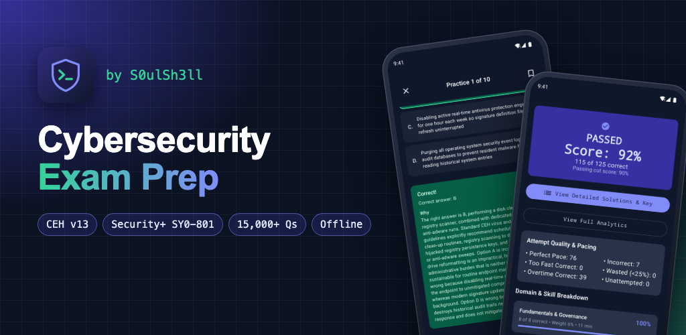
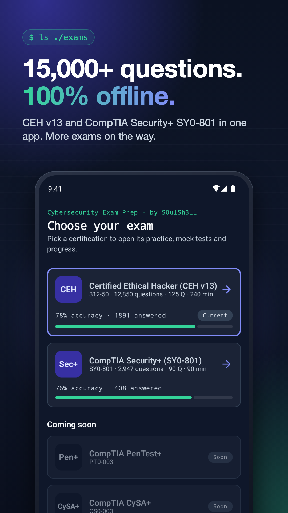
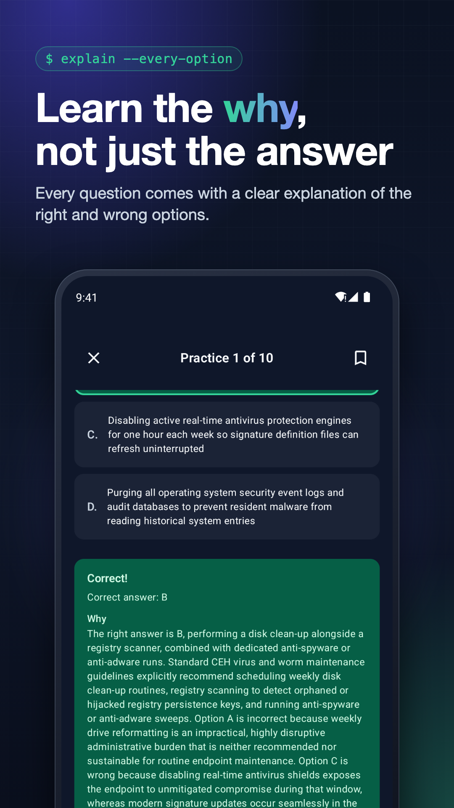
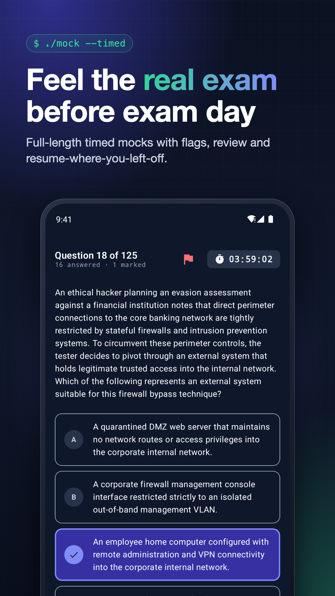
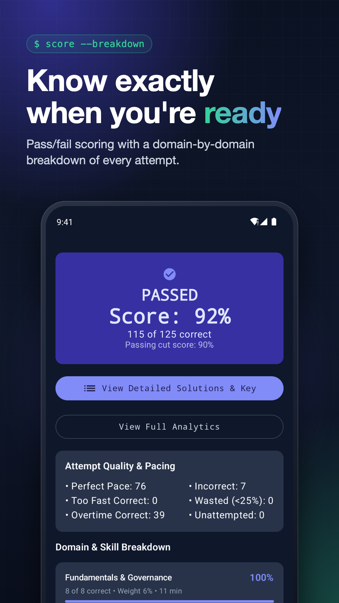
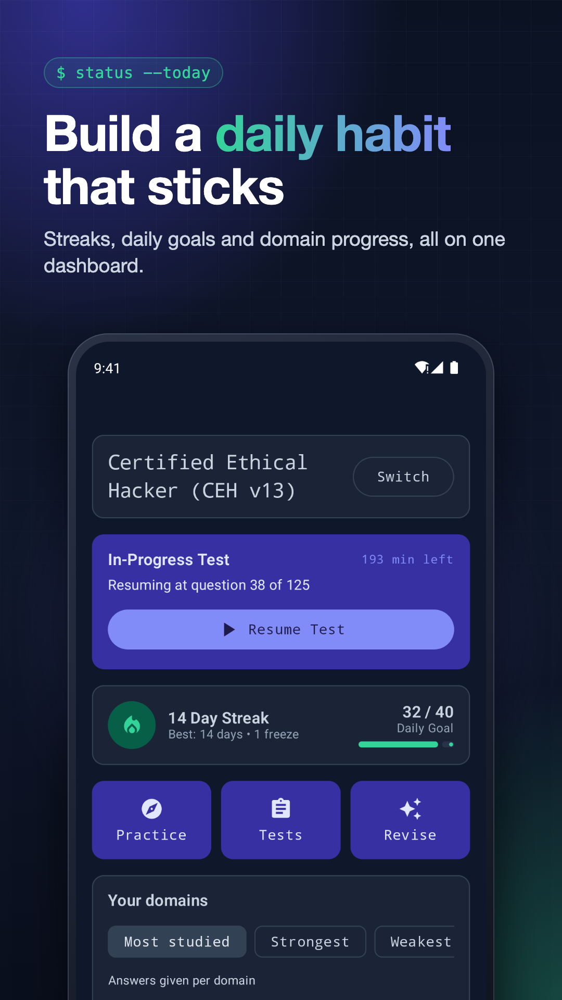
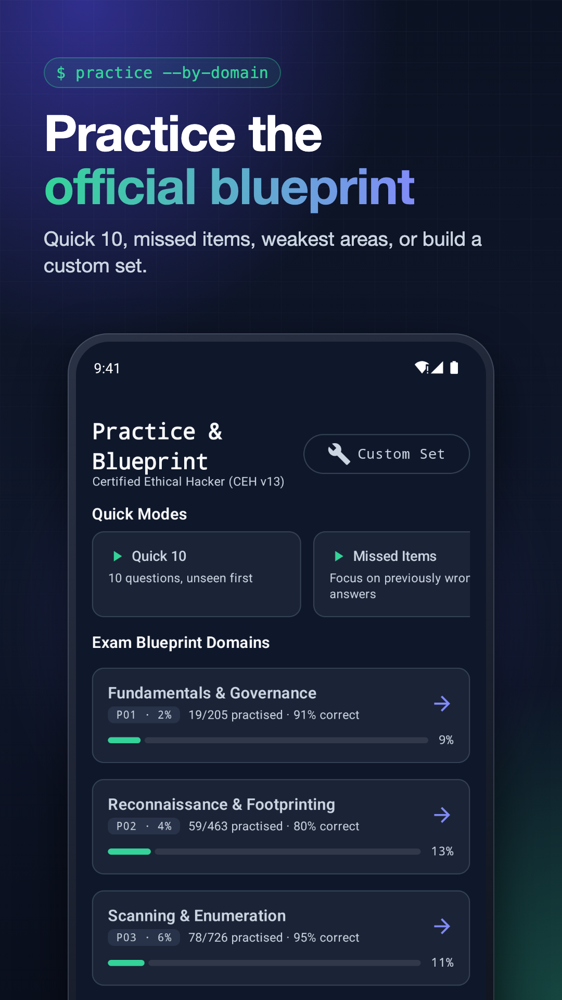
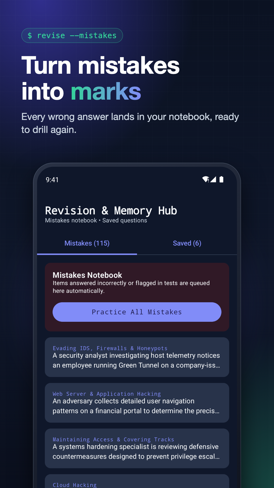
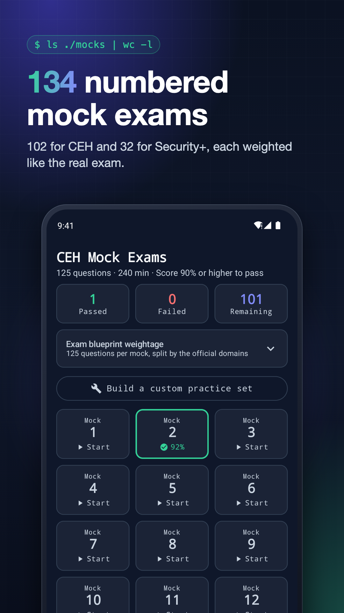

  

<h1 align="center">Cybersecurity Exam Prep</h1>

  <b>15,000+ offline practice questions and full-length timed mock exams for CEH v13 and CompTIA Security+ SY0-801.</b> 
  by S0ulSh3ll

<!-- PLAY STORE LINK: replace PLAY_STORE_URL below with the Google Play listing URL once the app is live -->

  

  <a href="PRIVACY.md">Privacy Policy</a> ·
  <a href="mailto:rishabhdahiya.work@gmail.com">Contact</a>

---

## Why this app

Passing a security certification takes more than reading notes. You need hundreds of exam-style
questions, honest feedback and full mock exams under a real timer. Cybersecurity Exam Prep gives you
all of it in one app that works completely offline: on the train, on a flight, or anywhere without signal.

| | CEH v13 (312-50) | CompTIA Security+ (SY0-801) |
|---|---|---|
| Practice questions | 12,850 | 2,947 |
| Numbered mock exams | 102 | 32 |
| Mock format | 125 questions · 240 min | 90 questions · 90 min |
| Blueprint | Weighted by the official domains | Weighted by the official domains |

More exams are on the way: CompTIA PenTest+, CySA+ and Network+.

## Features

- **Practice by blueprint domain.** Drill any domain, or use Quick 10, Missed Items and Weakest Area modes, or build your own custom set.
- **Every answer explained.** See why the right option is right and why each wrong option is wrong.
- **Real exam pressure.** Full-length timed mock exams with flag-for-review, a question palette and auto-submit. Close the app and you resume at the same question and time.
- **Know when you're ready.** Pass/fail scoring with a 90% pass mark, so you walk in over-prepared, plus a domain-by-domain breakdown and pacing insights.
- **Mistakes notebook.** Every wrong answer is saved automatically, ready to practise again. Bookmark tricky questions too.
- **Daily habit.** Streaks, a daily goal and an optional offline study reminder.
- **Easy on the eyes.** Dark and AMOLED-black themes, plus an adjustable reading font size.
- **Private by design.** No account, no sign-in. Your progress stays on your device.

## Screenshots

  
  
  
  

  
  
  
  

## Download

<!-- PLAY STORE LINK: replace PLAY_STORE_URL below too -->
Available on [Google Play](PLAY_STORE_URL) for Android phones and tablets (Android 7.0 and later).

## Privacy

The app has no accounts, and your study data never leaves your device. It shows Google AdMob ads,
and you can manage ad consent in the app. Read the full [Privacy Policy](PRIVACY.md).

## Support

Found a wrong answer, a typo or a bug? Email **rishabhdahiya.work@gmail.com** and include the question
text or a description of what happened.

## Disclaimer

Cybersecurity Exam Prep is an independent study aid. It is not affiliated with, endorsed by, or sponsored by
EC-Council or CompTIA. CEH and Certified Ethical Hacker are trademarks of EC-Council. CompTIA and Security+
are trademarks of CompTIA, Inc. All questions are original practice material, not real exam questions.

© 2026 S0ulSh3ll (Rishabh Dahiya). All rights reserved. This repository hosts the app's public
information and privacy policy only.
